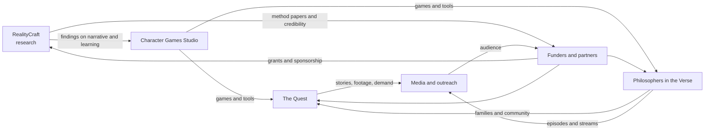

# MIHLab Business Plan (November 2026 draft)

**Moral Imagination and Hope Laboratory (MIHLab)** · Founder: Montaque "Monty" Reynolds, PhD · DeLand, Florida

> **Status:** a working draft that updates the earlier plan, the [[MIHLab Community Events Business Model—Questionnaire|Community Events questionnaire]] (library events and birthday parties, a $22,000 Year-1 target). It folds in everything added since: four program lines, the church-partner decision, and the research done in November 2026. **Every dollar figure below is a placeholder or an example unless it's marked as your own answer.** Sources are linked in §11.

## 1. Summary
MIHLab teaches people to think philosophically about who a person is, using narrative media (games, books and stories) as laboratories. It runs **four lines of work**. One shared method links them: *read a text, then step into a world where a choice is genuinely hard, then reflect.*

| Line | What it is | Who it serves | How it earns or is funded | Stage |
|---|---|---|---|---|
| **RealityCraft** (research) | LLM agents in Minecraft (Mindcraft-CE) testing how an agent's self-narrative shapes its learning | Researchers, AI labs | Grants, compute credits; later, LLM moral-reasoning evaluation as a service | Server running; benchmark built; questions defined |
| **The Quest** (Wilderness Ministry) | Multiday family backpacking or bikepacking trips run as one live story (eduLARP) | Families with children; churches; Scout units | Per-family fee; church adoption; game-master fees | Researched; curriculum drafted; ready for a one-day pilot |
| **Philosophers in the Verse** (Great Books in Space) | Read philosophy, find its thought experiment, play it out in a space sim; plus the in-game interview series and community game events | Teens, families, adult learners, libraries | Library and event fees; online seasons; sponsorship | Interviews recorded; events priced in the 2026 questionnaire |
| **Character Games Studio** | Games where players face real moral choices: the Experience Machine and the multiplayer philosophy D&D game | Kids, families, classrooms, churches | Per-title store sales; direct group licenses | Built solo at no cost; Meta store planned first |

**Partners and funding base:** churches, youth ministries, Christian schools and co-ops, and faith-based funders (decided October 2026). The audience stays open to anyone, with no belief required.

## 2. Mission and method
- **Mission:** teach philosophical thinking about who a person is, through narrative media.
- **Diagnosis:** narrative industries hand young people narrow scripts about what they are.
- **Answer:** Scripture is a *broader* script. It settles a person's worth and standing and leaves character and vocation open to wrestle with.
- **Method:** open worlds hold real constraints and consequences but never tell the player what they are *for*. MIHLab never pronounces a verdict on a person. Its feedback describes acts.
- **Openness:** curriculum modules stay Creative Commons.

## 3. What changed since the last plan
| Then (summer 2026 questionnaire) | Now (November 2026) |
|---|---|
| One business: community game events (libraries, birthday parties) | Four program lines, with community events folded into Philosophers in the Verse |
| Secular-first audience (libraries, schools) | Churches as primary partners and funders; the audience stays open |
| Year-1 revenue target of $22,000; break-even at $500 a month | Target kept as a benchmark (see §7); new income lines added |
| "Will you sell data? No" | Firm rule: **no participant data is ever used in research.** RealityCraft studies AI agents only |
| Insurance "not needed until expansion" | The Quest brings minors into the wilderness, so insurance and background checks are needed from the first trip (§8) |
| Solo | COO (Stephen Snyder) and CTO (Owen Goodwin) named; volunteer Guides planned for The Quest |

## 4. How the four lines fit together

The **programs** (The Quest and Philosophers in the Verse) reach people. The **studio** turns the method into products that travel without Monty in the room. **RealityCraft** supplies research credibility for funders.

## 5. The four lines in detail

### 5.1 RealityCraft: research arm
- **Questions:** (1) Does a narrative identity change how an agent learns from other agents? (2) Can awe and wonder increase exploration? (3) Do agents learn differently from stories than from instructions (Stump)? (4) What counts as a cognitive technology for narrative learning (De Cruz)?
- **Assets:** a Mindcraft-CE server with Andy, Jill, a Groq bot and a Gemini bot; a model benchmark (handoff, October 2026); persona-file experiments already logged.
- **Gap MIHLab fills:** no published work found tests awe or wonder in agents.
- **Money:** near-zero costs (owned hardware, $100 AMD compute credit, free API tiers). Funding comes from grants (the Templeton Foundation is the best fit) and later possibly **LLM moral-reasoning evaluation** for clients.
- **Ethics:** agents only, so likely no IRB review is needed. Keep research and programs separate on paper.
- **Next 90 days:** run the benchmark on the live server; pick Question 1 as the first study; post a preprint plan.
- Detail: [MIHLab Research Arm report](https://claude.ai/artifact/LCRXK8zywLFT4MwyYaMSMM) · [[Logs]]

### 5.2 The Quest: Wilderness Ministry
- **What:** families hike or bike together for a weekend or a summer week. The route *is* the story; roles are real trip jobs; choices move a character's tokens on a four-quadrant board; each night ends in a debrief circle; the trip ends with a blessing scene.
- **Model:** a church adopts The Quest as a ministry, on the Faithful Fathering pattern. An **outfitter runs the first 1–2 trips**, then trained volunteer Guides take over at about one Guide per four players.
- **Example pricing** (placeholders, 12 people per trip):

| Program | With an outfitter | Volunteer-run |
|---|---|---|
| Weekend (2 days, 1 night) | about $552 per person | about $222 per person |
| Summer week (6 days, 5 nights) | about $1,487 per person | about $497 per person |

- **MIHLab income:** game-master fees, for example $500 per weekend and $1,500 per summer week, or **about $5,000 a year** for 4 weekends and 2 weeks.
- **Curriculum:** three-day arc built from *Lumen*'s structure, Bible 5e's world and *Game Wrap*'s classroom lessons (see [[Multiday Adventure Curriculum Design]]).
- **First partners:** Salty Church (Ormond Beach); the Central Florida Council (Scouting); Hike It Florida; the Florida Trail Association.
- **Next 90 days:** a one-day den pilot (non-contact, Scouting-compliant); talk with Salty Church leadership; get a quote from Hike It Florida; Wilderness First Aid course.
- Detail: [[The Quest Comparable Programs Booklet]] · [eduLARP drive](eduLARP/eduLARP%20Resource%20Drive.md)

### 5.3 Philosophers in the Verse: Great Books in Space and community events
- **What:** read a short text with Shared Inquiry; find its thought experiment (Parfit, Nozick, Descartes); design it into Elite Dangerous, EVE Online or Star Citizen; play; debrief. Alongside it run the **in-universe interview series** (two recorded, two scheduled) and **community game events**.
- **Your 2026 event assumptions:** library events "$200 dollars to start" in 4-hour blocks; birthday parties at a flat package (10 kids, 2 hours); "4 events per month"; ramping from 1–2 a month to 8 a month by months 7–12; "$50" travel per event; your time at "$30/hr"; a 5-PC lab by "Summer 2027."
- **Partners:** public libraries (following the BGG Foundation's library model); the Great Books Foundation (Shared Inquiry training); homeschool co-ops; churches hosting game nights.
- **Hardware:** EVE is free to start; Elite runs on 8 GB machines; Star Citizen needs about 32 GB of RAM.
- **Next 90 days:** book the first library session; finish and publish the edited interview; open a Discord.
- Detail: [[MIHLab Great Books in Space Program Research and Planning Guide]]

### 5.4 Character Games Studio
- **What:** the Experience Machine (WebXR and Quest) and the multiplayer philosophy D&D game (up to six players).
- **Model:** solo development with free tools and **no spending**; sell each title on the **Meta Horizon Store first** (free to join, 30% cut), then Apple (15% for small developers, about $99 a year).
- **Example:** a $10 game nets $7 on Meta; **500 copies is about $3,500.** Your time is the real cost: 200 hours at 1,000 Apple sales works out to about $42 an hour.
- **Must-dos:** COPPA (no personal data from under-13s, no open chat); an IARC age rating; no ads or loot boxes.
- **Next 90 days:** open a Coming Soon page for the first title; start a Discord and an email list; playtest with Scout and church families.
- Detail: [[MIHLab Character Games Studio Program Research and Planning Guide]]

## 6. Market and positioning
- **Gap:** no program found combines a moving family expedition with a continuous story. No program combines a Great Books reading with space-sim play. Few studios make games explicitly for character formation, and no published agent research tests awe or wonder. MIHLab sits in all four gaps with one method.
- **Closest comparables:** Renaissance Adventures, The Story School, WildWise School, *Lumen* (EDGE), Voice of Wilderness with Faithful Fathering, the Great Books Foundation, the BGG Foundation, iThrive Games.
- **Credibility:** a philosophy PhD, active university teaching, and open Creative Commons materials.

## 7. Year-1 money picture (illustrative, not a forecast)
**Income scenario for 2027:**
| Line | Assumption | Year-1 |
|---|---|---|
| Community game events | Your ramp: 1–2 a month (months 1–3), 4–6 (months 4–6), 8 (months 7–12), about 67 events × $200 | about $13,400 |
| The Quest | Game-master fees for 4 weekends and 2 summer weeks | about $5,000 |
| Games studio | One title, 500 copies at $10 on Meta | about $3,500 |
| RealityCraft | Grants not yet applied for | $0 |
| **Total** | | **about $21,900** |

This lands close to your $22,000 target, but only if every event actually happens. At $200 an event, community events alone fall short of your target. Reaching it from events would take an average of about $330 an event, or adding birthday parties. **Grants are the swing factor** and aren't counted.

**Annual costs (placeholders):**
| Item | Year 1 |
|---|---|
| General liability insurance (needed once The Quest runs with minors) | about $600 |
| Attorney review: waivers, contracts, privacy policy | about $1,000 (one-time) |
| Wilderness First Responder certification | about $935 (one-time) |
| Florida LLC annual report | about $139 |
| Apple developer account | about $99 |
| Marketing (your answer: $20 a month) and buffer ($20 a month) | $480 |
| Event travel (your answer: $50 per event) | about $3,350 at 67 events |
| Optional tech insurance (E&O, cyber), only once games collect data or have revenue | about $3,150 |
| **Core total** (without the optional tech insurance) | **about $6,600** |

**Reading it:** Year 1 can pay for itself only if the event ramp holds. Your own labor, at your $30 an hour, isn't in these costs. Trip costs pass through to families or churches.

## 8. Legal and compliance checklist
- [ ] **Confirm LLC status.** Your profile says MIHLab is a registered Florida LLC, but the campaign notes say "the LLC doesn't exist." Check Sunbiz.
- [ ] **Fiscal sponsor** for tax-deductible gifts, since some faith-based funders can only give through a nonprofit.
- [ ] **The Quest:** Florida Level 2 background checks for adults working with minors; waivers; insurance (the church's, the outfitter's, or MIHLab's own); Scouting's no-striking rule; Florida seller-of-travel registration if MIHLab sells the trips ($300 plus a bond).
- [ ] **Studio:** COPPA; age ratings; privacy policy.
- [ ] **eduLARP materials:** *Lumen* and the EDGE courses are **CC BY-NC**. Borrow structures, write MIHLab's own scripts, or ask the authors.
- [ ] **RealityCraft:** no participant data, ever; check model licenses; follow Minecraft's terms for any public stream.
- This isn't legal advice. Confirm with an attorney, the Florida Department of Health and FDACS.

## 9. Team and capacity
| Role | Who | Notes |
|---|---|---|
| Founder and director; game master; researcher | Monty | Teaching four courses in Fall 2026 |
| COO (priorities, scheduling, the brake) | Stephen Snyder | Also co-editor of the *Annihilating Evil* volume |
| CTO | Owen Goodwin | Compensated with an equity share |
| Guides (The Quest) | Trained church volunteers | After the outfitter's first trips |
| Agent system | Claude Code "CEO agent" and role agents | In development |

## 10. Risks (honest)
1. **Capacity.** One founder carries four lines while teaching full-time. → Run **one pilot per line per semester**, and let the COO pick the order.
2. **Location.** The Quest and the library events are built on Florida partners, and a move back to the Seattle area is under consideration. → Make the Quest a *church-adoptable* model with a leader kit, so it can travel or be handed to a Florida church.
3. **Event ramp.** The $22,000 target depends on bookings that haven't happened yet. → Treat 2027 as a proof year and lead with grants.
4. **Liability with minors in the wilderness.** → Outfitter first, then certifications, insurance and background checks before any overnight.
5. **Frame drift.** Partners see different faces of MIHLab: ministry to churches, education to libraries, research to funders. → Use one method statement across all of them, with the audience-specific language from the marketing sections.
6. **Licensing.** EDGE and *Lumen* are non-commercial. → Original MIHLab materials only.

## 11. Next 12 months (proposal)
| When | RealityCraft | The Quest | Philosophers in the Verse | Studio |
|---|---|---|---|---|
| Nov–Dec 2026 | Run the benchmark; draft the Question 1 design | Talk with Salty Church; WFA course; one-day den pilot | Publish the edited interview; contact a library | Coming Soon page; Discord |
| Jan–Mar 2027 | First study; preprint | Outfitter quote; parent packet; den role-play warm-ups | First library sessions | Playtests with families |
| Apr–Jun 2027 | Templeton letter of intent | First outfitter-run family weekend | Online season pilot | Early Access release on Meta |
| Jul–Sep 2027 | Paper submission | Summer week (if the weekend succeeds) | 5-PC lab (your target) | Apple release |
| Oct–Dec 2027 | Evaluation-service pilot? | Hand off to volunteer Guides | Paid online cohort | Second title or group license |

## 12. Open decisions for Monty
- [ ] Which line launches first? The COO decides.
- [ ] Your real funding target: the $45,000 campaign figure, or something else.
- [ ] Does MIHLab sell the Quest trips, or does the church or outfitter (which affects seller-of-travel registration)?
- [ ] What ages are the games and the Great Books program for?
- [ ] Does research publish under MIHLab, Stetson, or both?

## Sources (vault and artifacts)
- [[MIHLab Community Events Business Model—Questionnaire]] (your 2026 assumptions)
- [[The Quest Comparable Programs Booklet]] · [online version](https://claude.ai/artifact/SxNk6E9an4tuaseuszF7wK)
- [[MIHLab Character Games Studio Program Research and Planning Guide]] · [online](https://claude.ai/artifact/4Fr6jWuyhvZb6dP4TmJW3U)
- [[MIHLab Great Books in Space Program Research and Planning Guide]] · [online](https://claude.ai/artifact/RM7y7KtqKMqrLWrdSVSgdh)
- [MIHLab Research Arm report](https://claude.ai/artifact/LCRXK8zywLFT4MwyYaMSMM) · [[Logs]] (RealityCraft)
- [[eduLARP Resource Drive]] · [[Multiday Adventure Curriculum Design]]
- MIHL project: *MIHLab Campaign Package*, *Model Benchmark Handoff*
